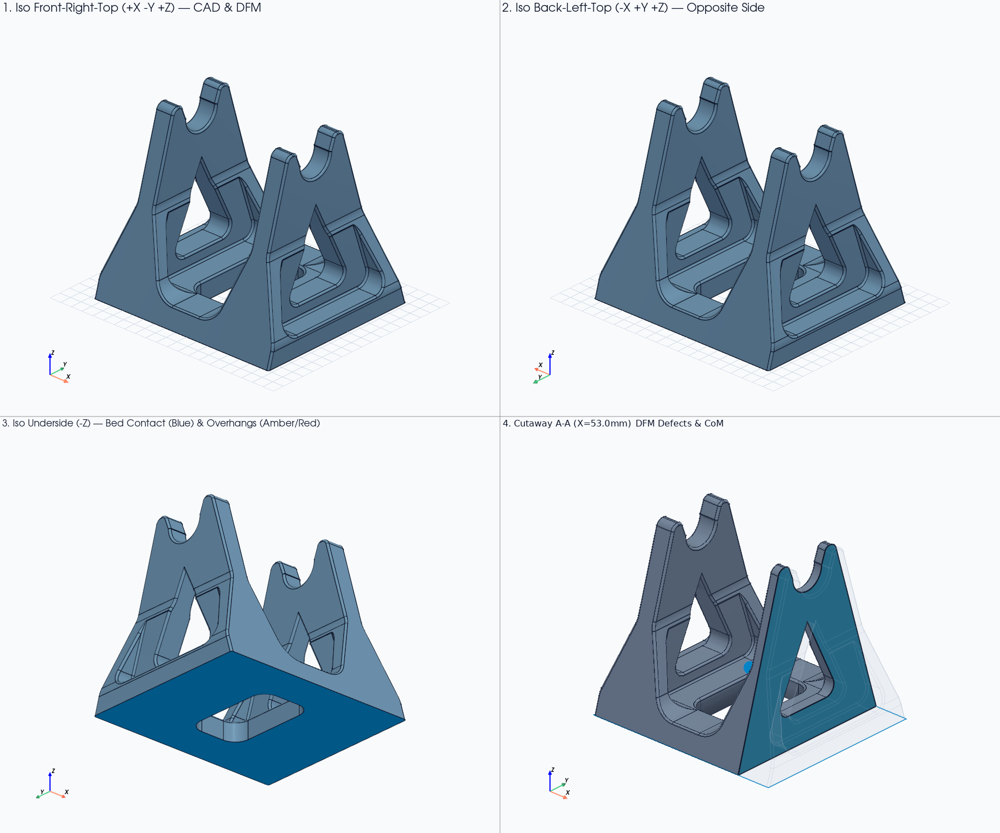
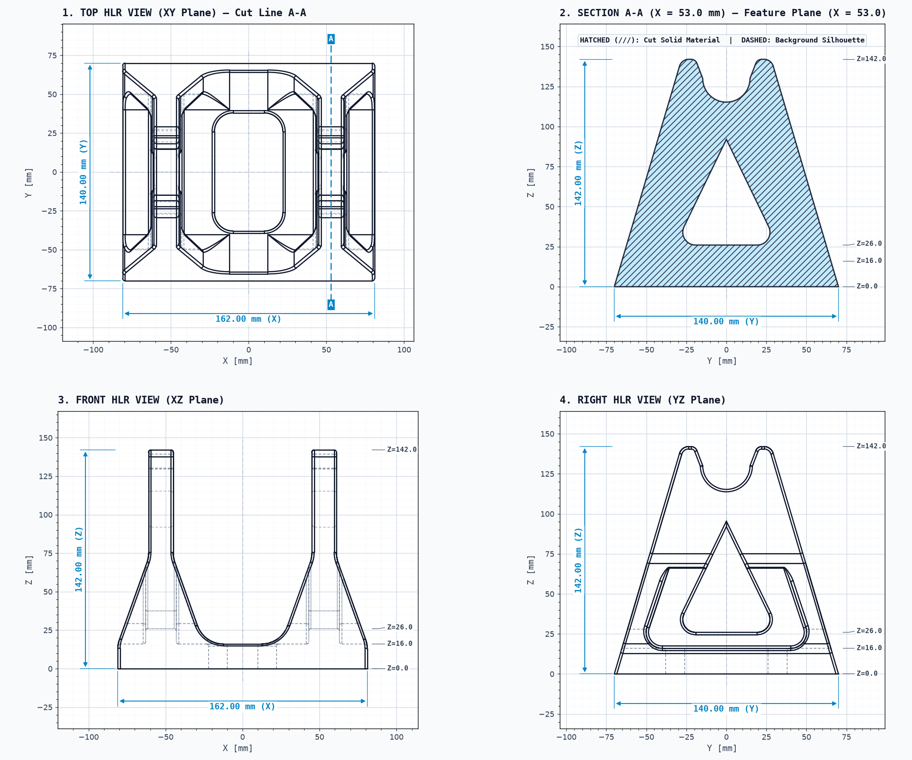
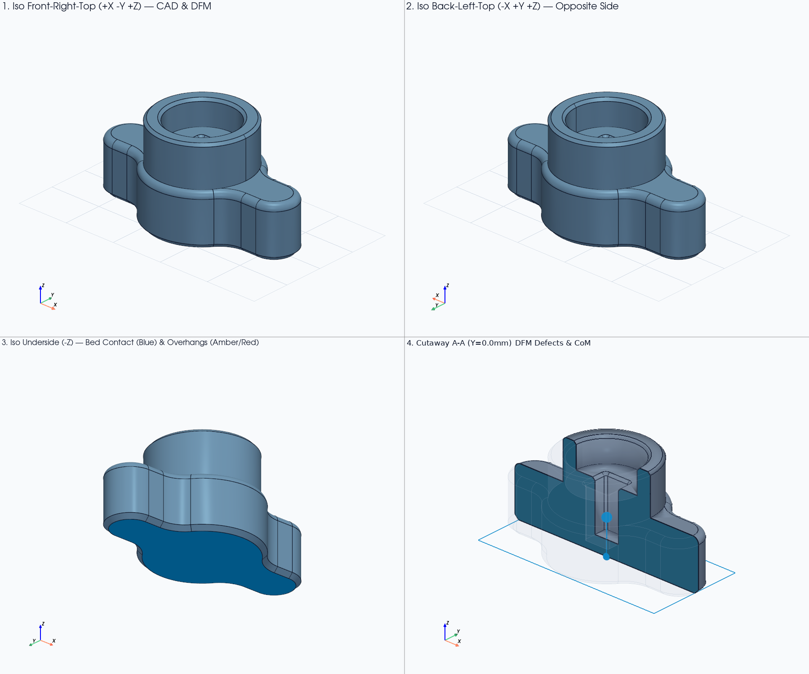
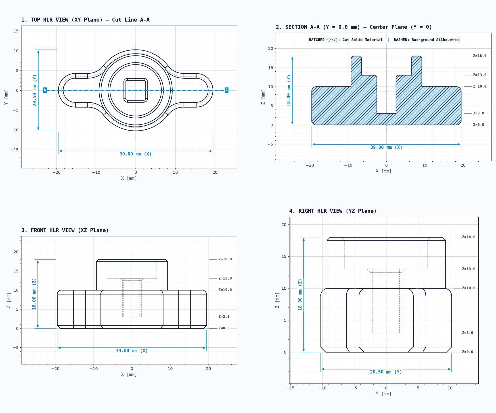

# CodeCad

Parametric 3D CAD models (`build123d`) for FDM 3D printing.

<!-- AUTO-GENERATED by generate_readme.py — do not edit manually. -->

## [dumbbell_stand](projects/dumbbell_stand/README.md) · [`dumbbell_stand.py`](projects/dumbbell_stand/dumbbell_stand.py)

  
  

## [valve_knob](projects/valve_knob/README.md) · [`valve_knob.py`](projects/valve_knob/valve_knob.py)

  
  

